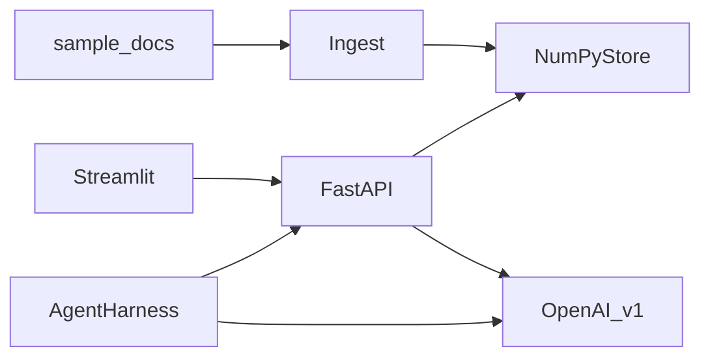
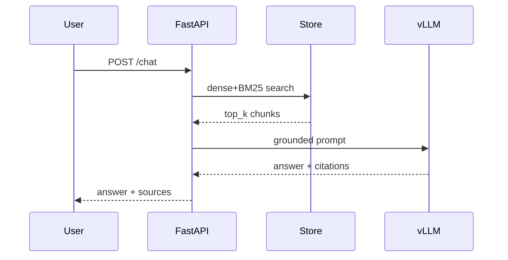
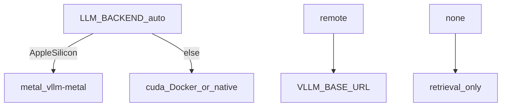
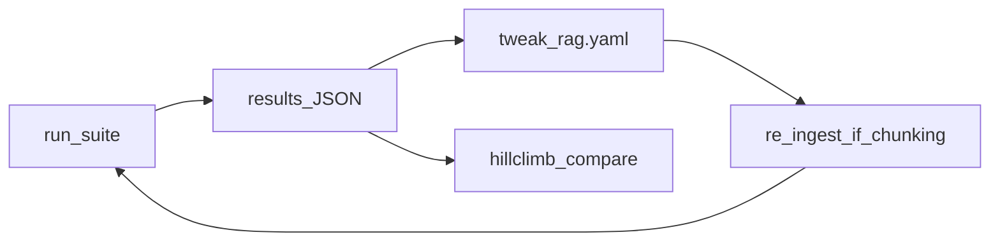

# vLLM RAG + Agent Harness

Local RAG + OpenAI-compatible LLM + hillclimb evals. Backend switch: `LLM_BACKEND=auto|cuda|metal|remote|none`.

## Stack



## Query path



## Backends



| Value | Default model | Serve |
| --- | --- | --- |
| `cuda` | Qwen2.5-7B | `docker compose up vllm` / native |
| `metal` | Qwen2.5-3B | [vllm-metal](https://github.com/vllm-project/vllm-metal) |
| `remote` | — | set `VLLM_BASE_URL` |
| `none` | — | no LLM |

```bash
python -m rag.doctor
python scripts/serve_llm.py --dry-run
```

## Run

```bash
python -m venv .venv && source .venv/bin/activate   # Windows: .\.venv\Scripts\Activate.ps1
pip install -e .
cp .env.example .env                                  # Windows: copy .env.example .env
python -m rag.doctor
python scripts/serve_llm.py                           # skip if remote/none
python -m rag.ingest sample_docs --reset
python -m rag.api                                     # :8080
streamlit run src/rag/ui.py
python -m harness.runner --suite smoke --mode retrieval
python -m harness.runner --suite smoke                # needs LLM + API
```

## Harness loop



```bash
python -m harness.runner --suite full --out results/a.json
# edit configs/rag.yaml (one knob)
python -m harness.runner --suite full --out results/b.json
python -m harness.hillclimb results/a.json results/b.json
```

## API

`GET /health` · `GET /config` · `POST /ingest` · `POST /search` · `POST /chunk` · `POST /chat` · `POST /chat/stream`

## Layout

`configs/` · `sample_docs/` · `src/rag/` · `harness/` · `scripts/`

## Tips

- OOM → lower `GPU_MEMORY_UTILIZATION` / `MAX_MODEL_LEN`, or use 3B / `remote` / `none`
- M2 → `auto`→`metal`; do **not** use NVIDIA Compose
- Empty search → re-ingest · `vllm.ok:false` until LLM is up is fine for `/search`
